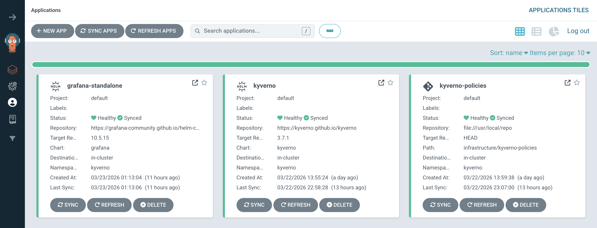

# Full Observability for Kyverno with Observability-as-Code

This repo is to reproduce the demo for KyvernoCON EU 2026 talk [Full Observability for Kyverno with Observability-as-Code](https://eyeveebee.dev/full-observability-for-kyverno-with-observability-as-code)

This is for demo-purposes only, it's not production-ready and does not apply best-practices. It's just to showcase how we can achieve Observability-as-Code in GitOps for Kyverno.

## Pre-requisites

- [Docker](https://docs.docker.com/engine/install/)
- [Git](https://git-scm.com/install/)
- (Optional) [Lens](https://lenshq.io/products/lens-k8s-ide)

## Setup 

We'll pre-install most o this for the live demo, as we have limited time during the session.

### Create k8s cluster and install ArgoCD

- Create [kind cluster](https://kind.sigs.k8s.io/) named `kyverno-demo` with `kind crate cluster --name kyverno-demo`
- Install [ArgoCD](https://argo-cd.readthedocs.io/en/stable/getting_started/)

### Deploy Prometheus and Tempo

Follow Kyverno documentation:

- https://kyverno.io/docs/guides/monitoring/#setting-up-prometheus
- https://kyverno.io/docs/guides/tracing/#installation-and-setup

### Deploy Kyberno and Grafana on ArgoCD

- [kyverno-app.yaml](./infrastructure/kyverno-app.yaml)
- [kyverno-policies-app](./infrastructure/kyverno-policies-app.yaml)
- [grafana-standalone.yaml](./apps/grafana/grafana-app.yaml)

```bash
kubectl apply -f infrastructure/kyverno-app.yaml
kubectl apply -f infrastructure/kyverno-policies-app.yaml
kubectl apply -f apps/grafana/grafana-app.yaml
```

After the install, port forward ArgoCD and Grafana:

```bash
kubectl port-forward -n kyverno service/grafana-standalone 3000:80
kubectl port-forward svc/argocd-server -n argocd 8080:443
```

And open https://localhost:8080/applications for ArgoCD:



And http://localhost:3000/ for Grafana. User and password `admin`.

## Live demo

- Grafana dashboard (alerts and annotations).
    - http://localhost:3000/d/Rg8lWBG7k/kyverno-metrics?orgId=1&from=now-1h&to=now&timezone=browser&var-DS_PROMETHEUS_KYVERNO=kyverno-prometheus-ds&var-cluster=$__all

    

- Tracing Kyverno requests, deploying a pod that passes or fails the kyverno custom policy [check-demo-label.yaml](./infrastructure/kyverno-policies/check-demo-label.yaml)

    ```bash
    # Deploy accepted
    kubectl run demo-pass --image=nginx:latest --labels="demo-approved=true" -n demo-app
    kubectl delete  pod demo-pass -n demo-app

    # Deploy denied
    kubectl run demo-fail --image=nginx:latest --labels="demo-approved=false" -n demo-app 
    ```

    

    

    

## Clean-up

```bash
kind delete cluster --name kyverno-demo
```