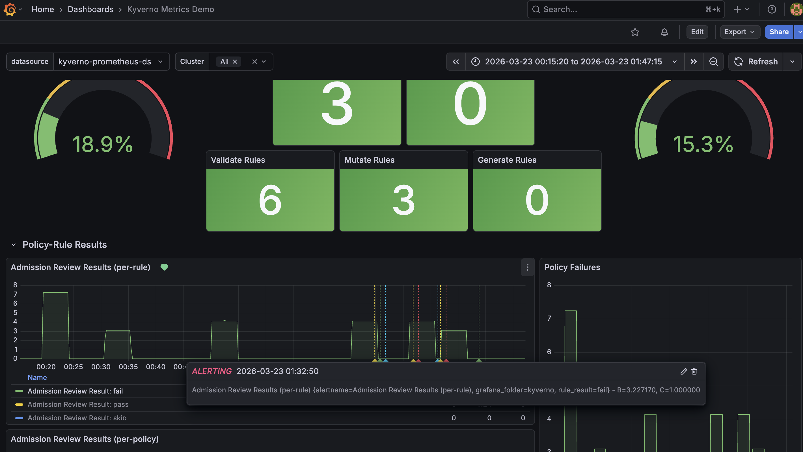
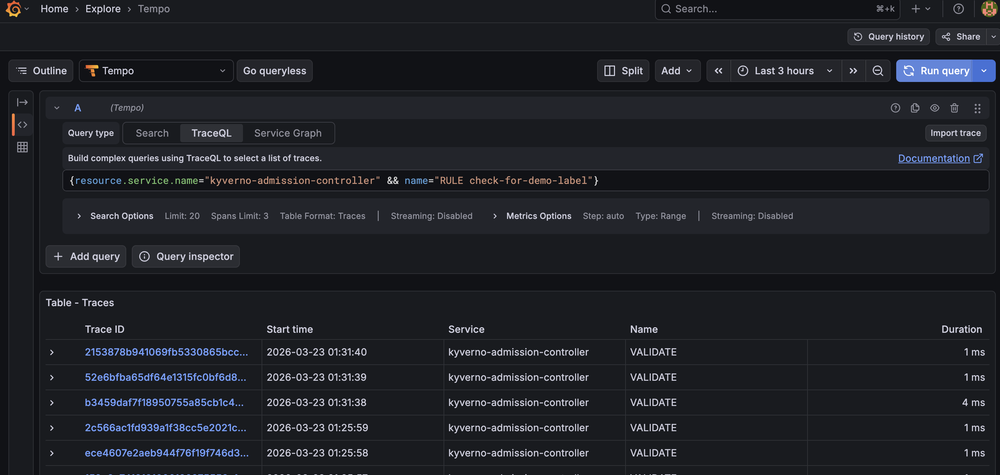
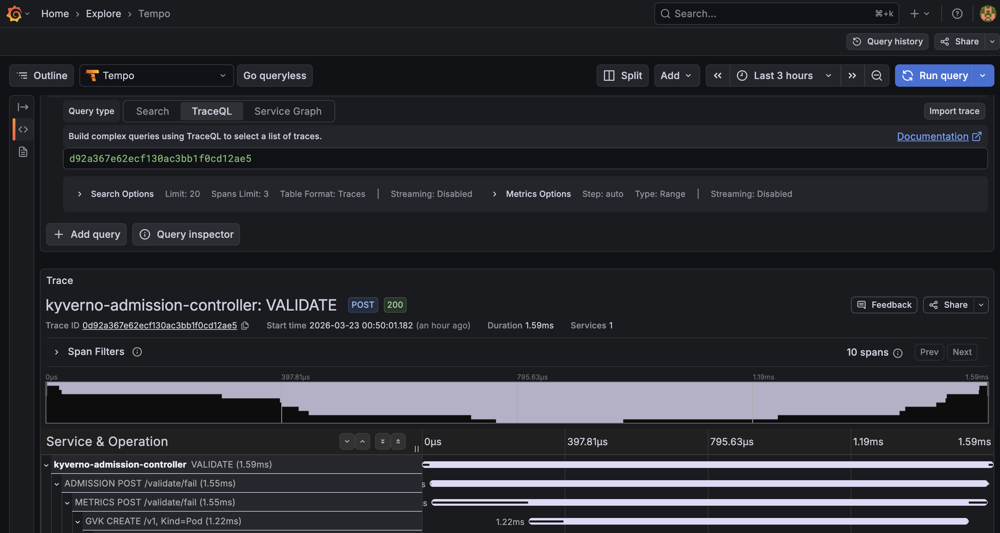
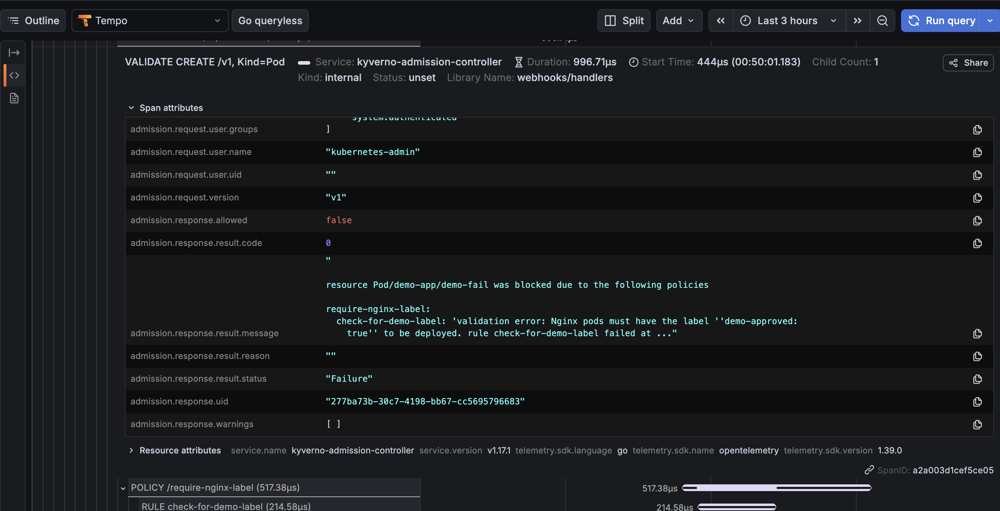

# Full Observability for Kyverno with Observability-as-Code

This repo is to reproduce the demo for KyvernoCON EU 2026 talk [Full Observability for Kyverno with Observability-as-Code](https://eyeveebee.dev/full-observability-for-kyverno-with-observability-as-code)

## Pre-requisites

- Docker
- Git
- (Optional) Lens

## Setup 

### Create k8s cluster and install ArgoCD

- Create kind cluster `kyverno-demo`
- Install ArgoCD

### Deploy Prometheus and Tempo

Follow Kyverno documentation:

- https://kyverno.io/docs/guides/monitoring/#setting-up-prometheus
- https://kyverno.io/docs/guides/tracing/#installation-and-setup

### Deploy apps on ArgoCD

- [kyverno-app.yaml](./infraestructure/kyverno-app.yaml)
- [kyverno-policies-app](./infraestructure/kyverno-policies-app.yaml)
- [grafana-standalone.yaml](./apps/grafana/grafana-app.yaml)

## Demo

- Grafana dashboard (alerts and annotations).
    - http://localhost:3000/d/Rg8lWBG7k/kyverno-metrics?orgId=1&from=now-1h&to=now&timezone=browser&var-DS_PROMETHEUS_KYVERNO=kyverno-prometheus-ds&var-cluster=$__all

    

- Tracing kyverno requests (deploy a pod that passes or fails a kyverno custom policy)

    ```bash
    kubectl run demo-pass --image=nginx:latest --labels="demo-approved=true" -n demo-app
    kubectl delete  pod demo-pass -n demo-app

    kubectl run demo-fail --image=nginx:latest --labels="demo-approved=false" -n demo-app 
    ```

    

    

    